<div align="center">


# 🪆 nvim-in-nvim

**Neovim inside Neovim inside Neovim: a Vim-like editor in Lua that has its own init.lua and can edit the config of another editor**

[](https://neovim.io)    [](https://github.com/Bobliuuu/nvim-in-nvim/releases/tag/v0.1.0) 

[🎬 Video](#video) · [💡 The idea](#idea) · [🚀 Try it](#try) · [🧩 How it works](#how-it-works) · [✅ Tests](#tests) · [🖼️ Gallery](#gallery) · [⚠️ Limitations](#caveats) · [🗺️ Repo map](#repo-map)

</div>

---

**Explainer video (voice-over and captions): the idea, the architecture, the tests, the limits**

[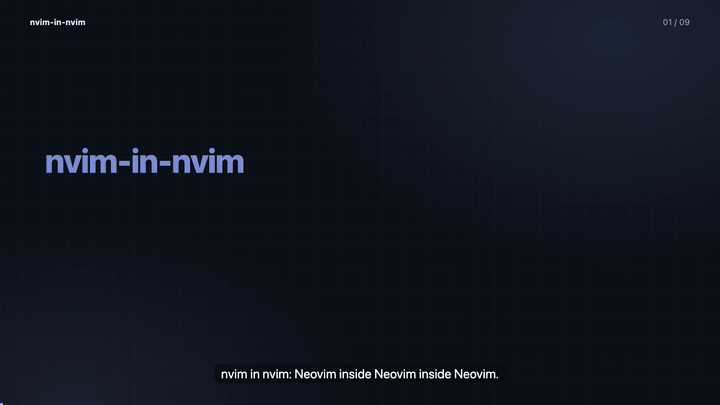](video/nvim_in_nvim_explainer.mp4)

<a id="video"></a>
A Vim-like editor written in about 1,955 lines of Lua (14 modules), running **on top of** Neovim using nothing but its public API, with its own `init.lua`
configuration system. The editors are *logical* editors, not extra processes: each has its own modes, cursor, registers, undo, buffers, mappings and
**its own Lua environment in which `vim` means "this editor"**. So an editor built from Neovim configuration can edit the configuration of another editor built from Neovim configuration.

<p align="center">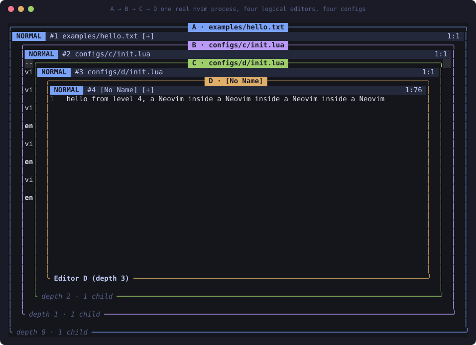</p>

<a id="idea"></a>

## 💡 The idea

```text
REAL NEOVIM  ── loads our init.lua
└── EDITOR A   (Lua)   configs/a/init.lua   number on,  Q → "Editor A"
    └── EDITOR B   (Lua)   configs/b/init.lua   number off, Q → "Editor B"
        └── EDITOR C   (Lua)   configs/c/init.lua   number on,  Q → "Editor C"
            └── EDITOR D   (Lua)   configs/d/init.lua   relative numbers …
```
The acceptance test runs automatically against a real terminal with raw bytes: **Editor B opens `configs/c/init.lua`, changes `"Editor C"` to `"Editor C was reconfigured"` using our own `/`, `i` and `:w`, then Editor C reloads and its `Q` mapping now says `Editor C was reconfigured`.**

<div align="center">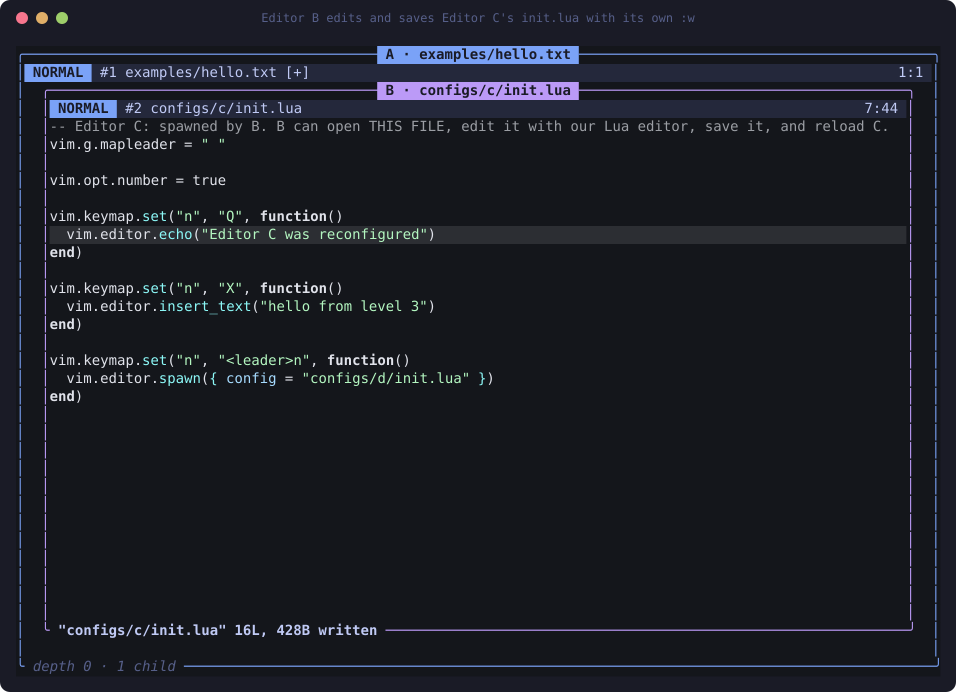</div>

<a id="try"></a>

## 🚀 Try it

```bash
brew install neovim            # needs 0.10+ (float footers); developed on 0.12.6
git clone https://github.com/Bobliuuu/nvim-in-nvim && cd nvim-in-nvim
nvim -u ./init.lua             # the real Neovim loads our init.lua, which boots Editor A
```
| keys | what happens |
|---|---|
| `Q` | Editor A's own mapping: footer says `Editor A` |
| `<Space>n` | A's mapping spawns **Editor B** (new buffer, new config, `number` off) |
| `<Space>n` again | B spawns **C**, then **D** |
| `:parent` / `:child` | move focus up/down the tree |
| in B: `:e! configs/c/init.lua` | open C's config, edit it with our own commands, save with `:w` |
| `:child` then `:reload` then `Q` | C re-executes the saved file |
| `:close` / `:q!` in A | close this editor / quit the real Neovim |
| `<C-\><C-\>` | emergency: step aside, native Neovim takes over |

The port of a real-world config running in layers: `RECURSIVE_VIM_CONFIG=configs/blog/init.lua nvim -u ./init.lua` (see [the full README](docs/README_FULL.md)).

<a id="how-it-works"></a>

## 🧩 How it works

1. **Stealing the keyboard.** `input.lua` registers the only `vim.on_key` hook; it returns `""` for every key, so Neovim's own machinery never runs. It also overrides `vim.paste` and reserves two emergency sequences.
2. **Routing.** The key goes to `Instances.focused`. Focus moves on `spawn`, `:parent`, `:child`, `:close`.
3. **Per-editor state.** Mode, cursor, registers, undo, buffers, mappings, options and children hang off the `Editor` object.
4. **Rendering.** `render.lua` is the only file that touches host windows; each editor is a float.

`d` is an operator and `w` is a motion; the parser glues them, so `dw`, `d$`, `c2w`, `yj`, `dG` all exist without being enumerated.

<p align="center">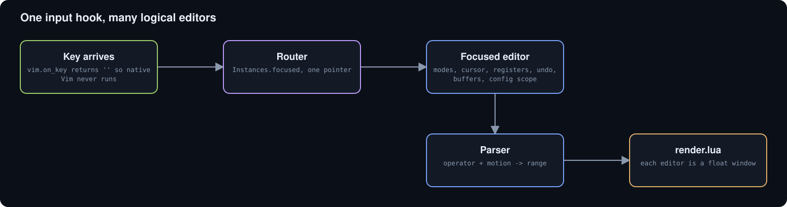</p>

<p align="center">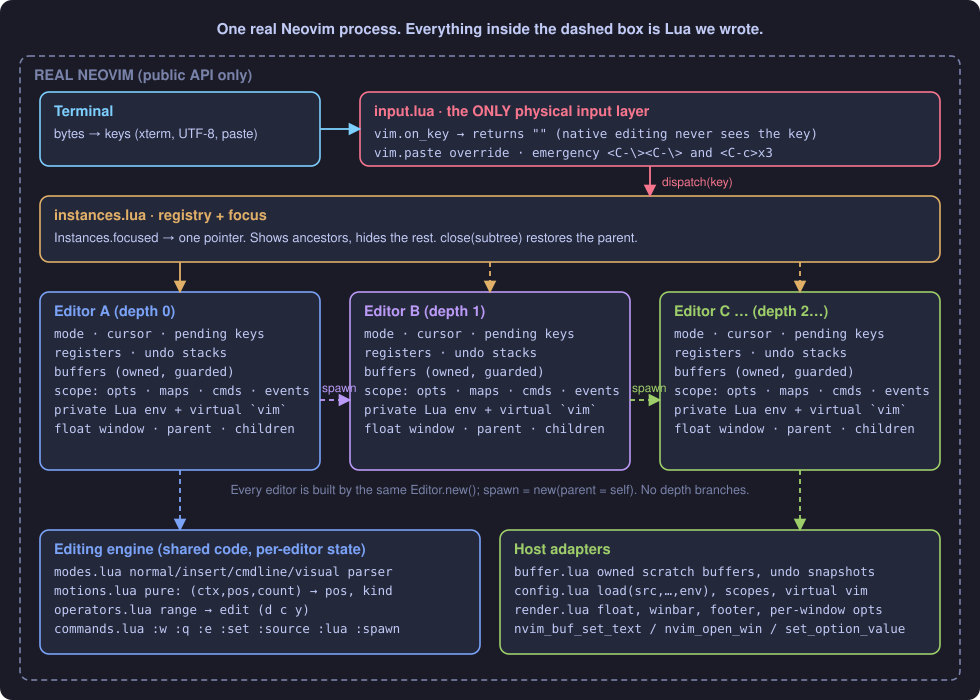</p>

<p align="center">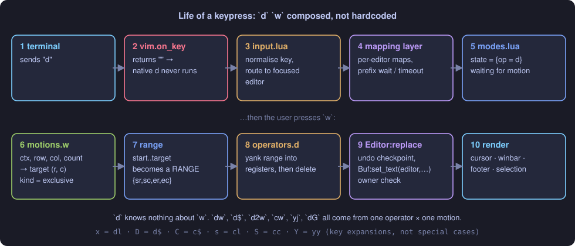</p>

<details>
<summary>Reload is a transaction</summary>

The config file runs against a *staging* scope; only if it finishes without error does it replace the editor's mappings, commands and options in one swap. A broken config reports its error in that editor, keeps the previous working config and never touches its parent.
<div align="center">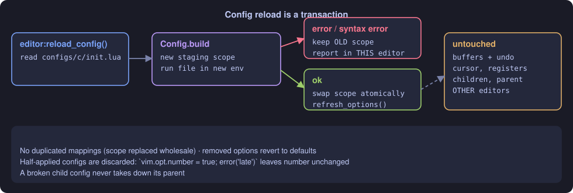</div>

</details>

<details>
<summary>Why configs cannot contaminate each other</summary>

Each config is compiled with `load(src, name, "t", env)` where `env` is a whitelist of Lua libraries and **that editor's** virtual `vim`.
<div align="center">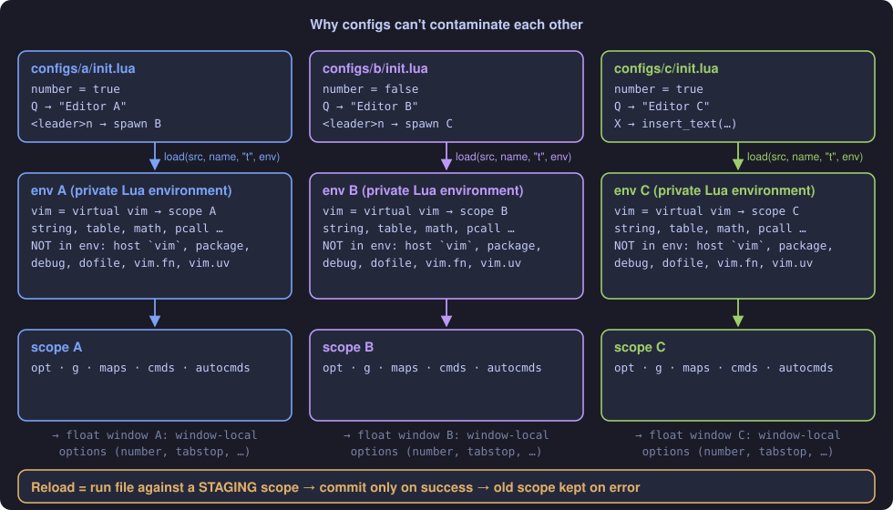</div>

</details>

<a id="tests"></a>

## ✅ Tests

`tests/run.sh` runs every layer. The counts below were recorded by `tools/record_tests.py` on Neovim 0.12.x.

| Lua specs | E2E checks (pty) | Input research |
|:---:|:---:|:---:|
| **67** | **66** | **22** |

**Test layers (results/tests.json, produced by tools/record_tests.py)**

| Layer | Passed | Of |
| :--- | ---: | ---: |
| Lua specs (headless nvim) | 67 | 67 |
| End-to-end (real TUI in a pty) | 49 | 49 |
| End-to-end (blog config layers) | 17 | 17 |
| Phase-0 input research | 22 | 22 |

<sub>Source: `results/derived/readme_data.json`</sub>

<p align="center"></p>

<a id="gallery"></a>

## 🖼️ Gallery

Real screen captures, rendered from a pty running the actual editor.

<table>
<tr>
<td width="50%">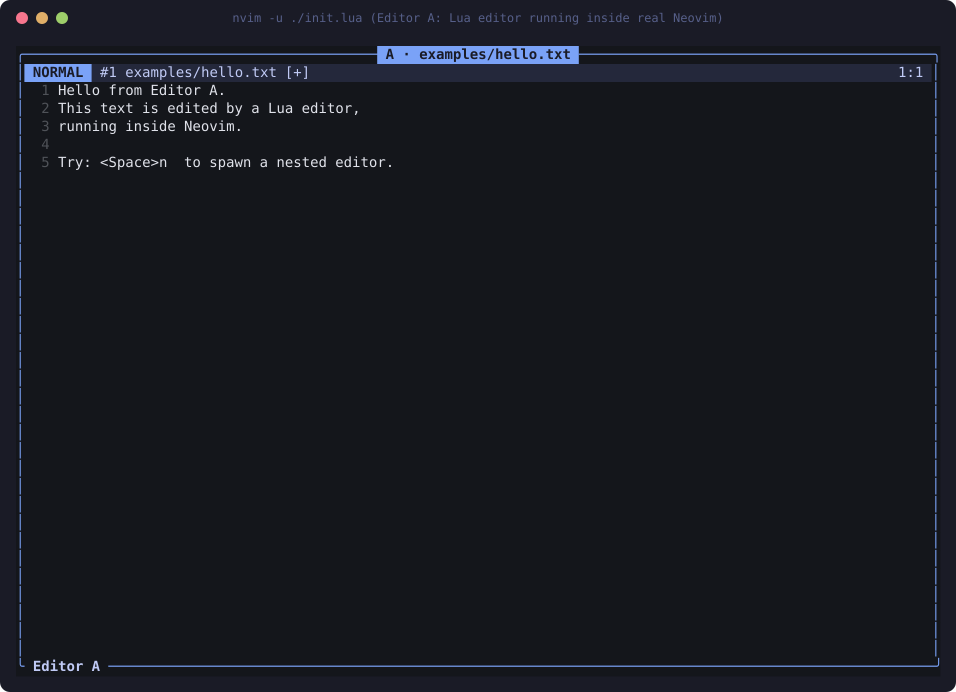<br><sub><b>Editor A</b></sub></td>
<td width="50%">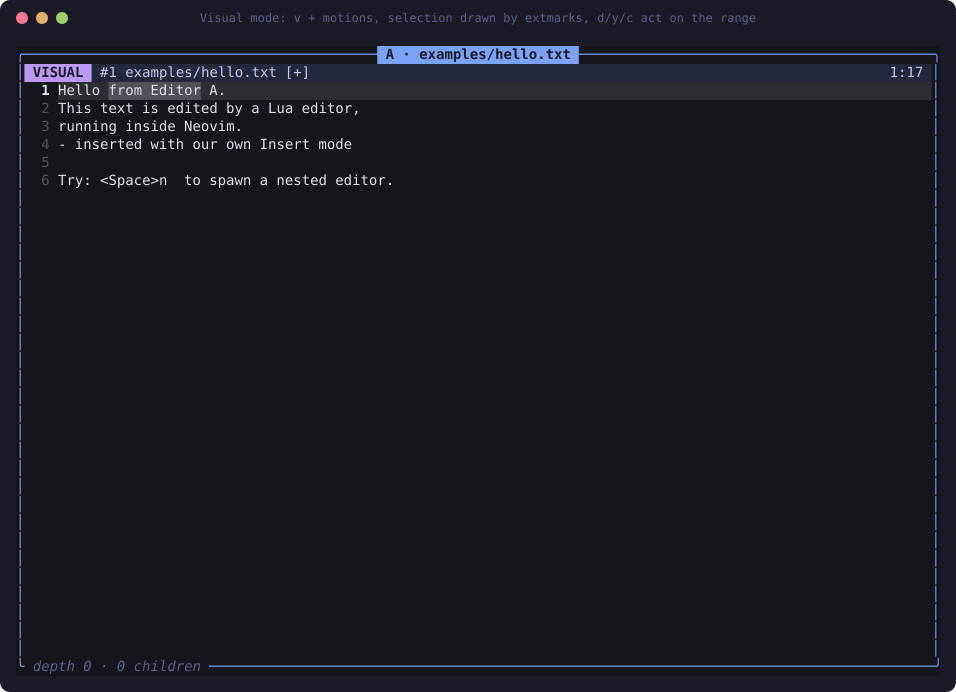<br><sub><b>Visual mode</b> drawn by extmarks</sub></td>
</tr>
<tr>
<td>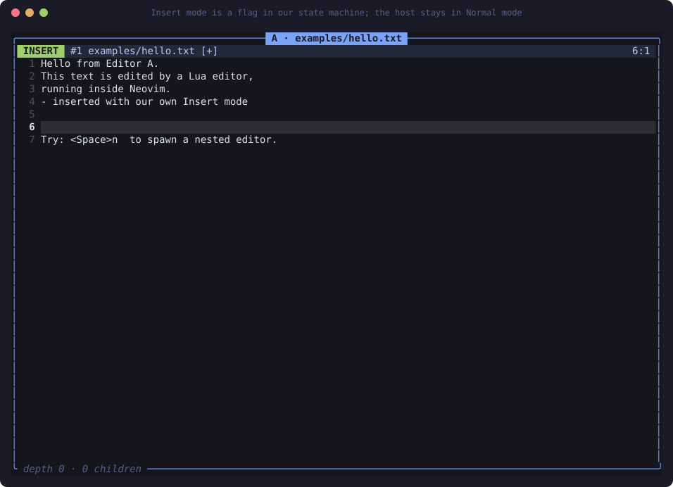<br><sub><b>Insert mode</b> is a flag in our state machine</sub></td>
<td>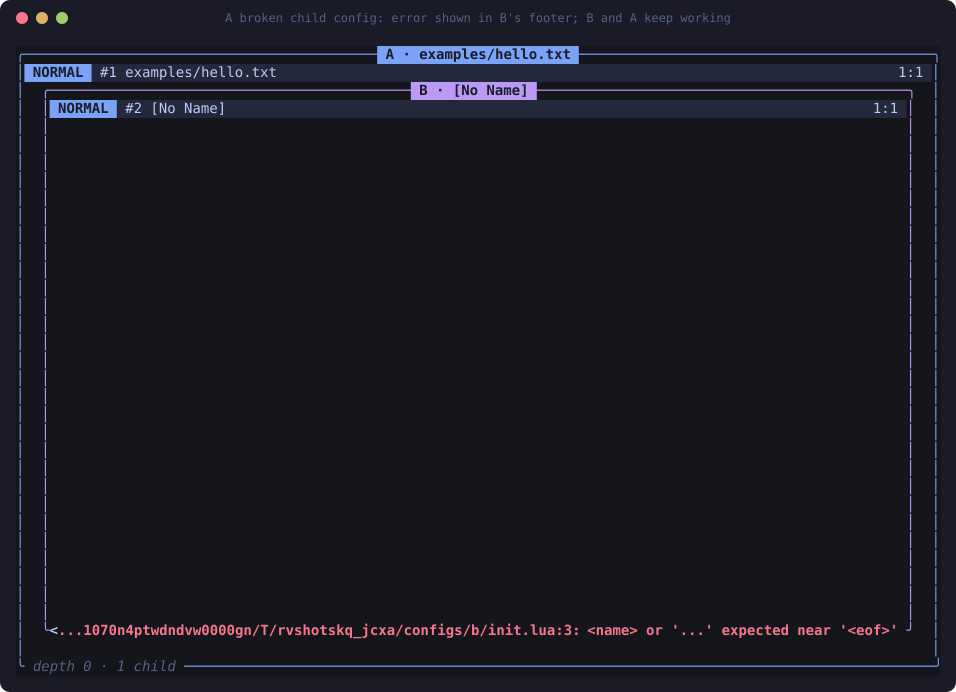<br><sub><b>Broken child config</b>: B shows the Lua error, still usable</sub></td>
</tr>
</table>

<a id="caveats"></a>

## ⚠️ Honest caveats

- Configs are **trusted code**: a private Lua environment isolates names and state, not capabilities (`os` and `io` are available).
- Not Vim: no regex search, folds, marks, macros, `:s`/`:g`, jump list, completion or mouse. Undo is linear whole-buffer snapshots.
- Insert counts (`3ix<Esc>`) are not implemented; a pending mapping prefix waits `timeoutlen` before falling back to the builtin.
- One physical terminal, so cursor shape is global. If the hook ever wedges: `<C-\><C-\>`.

<a id="repo-map"></a>

## 🗺️ Repo map

| Path | What it is |
|---|---|
| `init.lua` | nvim -u ./init.lua boots Editor A |
| `lua/recursive_vim/` | the editor: input, instances, editor, modes, motions, operators, registers, buffer, commands, config, render, text, keys |
| `configs/` | per-level init.lua files (a, b, c, d) and a ported real-world config (blog) |
| `tests/` | Lua specs, pty end-to-end tests and run.sh |
| `experiments/` | phase-0 input interception research |
| `tools/` | screenshots/diagrams, record_tests.py and readme_data.py |
| `docs/` | architecture, input research, discoveries, README_FULL.md (the earlier long README) |
| `README.spec.yml` | spec for video-readme-maker |
| `video/` | explainer mp4, srt, poster, preview.gif (generated) |

---

<div align="center"><sub>Generated with video-readme-maker from README.spec.yml and results/.</sub></div>
