> Full original README (kept for reference). The short README is [../README.md](../README.md).

<div align="center">

# nvim-in-nvim

### Neovim inside Neovim inside Neovim inside Neovim.

*A Vim-like editor written in ~1,900 lines of Lua, running **on top of** Neovim using nothing but its public API,
with its own `init.lua` configuration system, so the editor can edit the config of another editor that is itself an editor.*


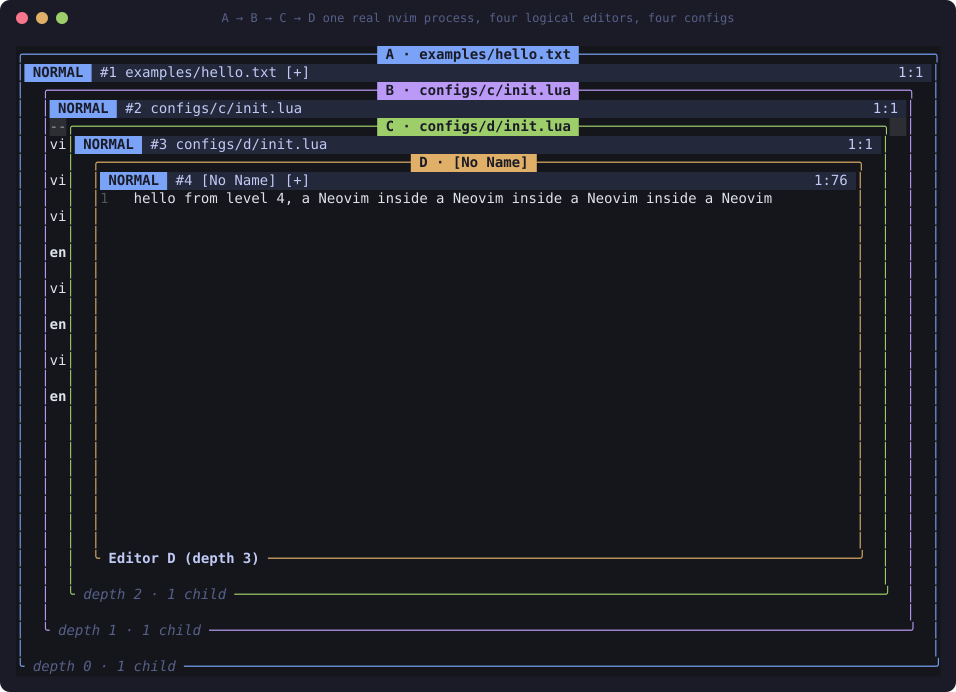

<sub>Real screen capture of <code>nvim -u ./init.lua</code> after pressing <code>&lt;Space&gt;n</code> three times. One OS process. Four logical editors. Four different <code>init.lua</code> files.</sub>

</div>

---

## The idea

```text
REAL NEOVIM  ── loads our init.lua
└── EDITOR A   (Lua)   configs/a/init.lua   number on,  Q → "Editor A"
    └── EDITOR B   (Lua)   configs/b/init.lua   number off, Q → "Editor B"
        └── EDITOR C   (Lua)   configs/c/init.lua   number on,  Q → "Editor C"
            └── EDITOR D   (Lua)   configs/d/init.lua   relative numbers …
```

The editors are **not** Neovim processes and not copies of your Neovim config. Each one is a *logical* editor implemented in Lua, with its own
modes, cursor, registers, undo history, buffers, key mappings, options, user commands, and **its own Lua environment in which `vim` means "this editor"**.

The punchline (this is the acceptance test, and it runs automatically against a real terminal with raw bytes):

> **Editor B opens `configs/c/init.lua`, changes `"Editor C"` to `"Editor C was reconfigured"` using our own `/`, `i` and `:w`,
> then Editor C reloads and its `Q` mapping now says `Editor C was reconfigured`.**
> An editor built from Neovim configuration edited the configuration of another editor built from Neovim configuration.

<div align="center">
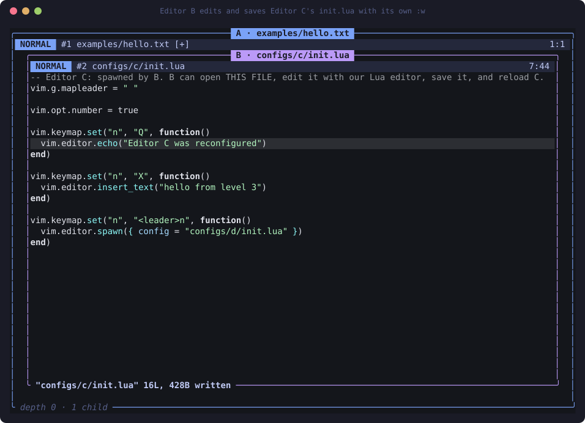
<br><sub>Editor B, mid-story: C's config edited with B's own Lua-implemented editing commands and saved with B's own <code>:w</code>.</sub>
</div>

## Try it

```bash
brew install neovim            # needs 0.10+ (float footers); developed on 0.12.6
git clone https://github.com/Bobliuuu/nvim-in-nvim && cd nvim-in-nvim
nvim -u ./init.lua             # the real Neovim loads our init.lua, which boots Editor A
```

### 60-second tour

| keys | what happens |
|---|---|
| `Q` | Editor A's own mapping: footer says `Editor A` |
| `<Space>n` | A's mapping spawns **Editor B** (new buffer, new config, `number` off) |
| `Q` | now B's mapping: `Editor B` |
| `<Space>n` | B spawns **C**, `X` in C inserts `hello from level 3`, `<Space>n` again spawns **D** |
| `:parent` / `:child` | move focus up/down the tree (children are hidden when you're above them) |
| in B: `:e! configs/c/init.lua` | open C's config, edit it with our `/`, `a`, `ciw`, `dd`…, save with `:w` |
| `:child` then `:reload` then `Q` | C re-executes the saved file → `Editor C was reconfigured` |
| `:close` | close this editor (and its subtree), focus returns to the parent |
| `:q!` in A | quit the real Neovim |
| `<C-c><C-c><C-c>` | emergency: reset this editor's logical state |
| `<C-\><C-\>` | emergency: step aside, native Neovim takes over (press again to come back) |

## What the editor can do

<table>
<tr><td>

**Modes** normal · insert · command-line · visual (`v` `V`)<br>
**Motions** `h j k l w b e 0 ^ $ gg G n N` `/search`<br>
**Operators** `d c y` (composable, not hardcoded)<br>
**Text objects** `iw aw`<br>
**Counts** `5j` `3w` `2dd` `d2w` `2d3w`<br>
**Insert** `i a I A o O` `<CR>` `<BS>` `<Tab>` arrows<br>
**Editing** `x X D C s S Y J r p P` `"ayy` registers<br>
**Undo/redo** `u` `<C-r>` · **dot-repeat** `.`

</td><td>

**Ex** `:w :q :wq :e[!] :set :source :lua :Cmd`<br>
**Nesting** `:spawn :parent :child :close :reload`<br>
**Buffers** `:ls :bnext :bprev`<br>
**UI** line numbers, cursorline, statusline-ish winbar, treesitter highlighting for `.lua`, nested colored frames<br>
**Real files** open, edit, save<br>
**Config** per-instance, hot-reloadable

</td></tr>
</table>

`d` is an operator and `w` is a motion; the parser glues them, so `dw`, `d$`, `c2w`, `yj`, `dG`… all exist without being enumerated.
Even `x` is just `dl`, and `D` is `d$`.

## Bonus: someone else's real-world config, running *inside* the layered Neovim

I took the setup from [“Neovim isn't actually that scary”](https://www.alvinayang.com/blogs/neovim-isnt-actually-that-scary) and ported it to
[`configs/blog/`](../configs/blog/init.lua). The original leans on ~40 plugins (lazy.nvim, Telescope, nvim-tree, LSP…), and this project has **zero plugins by
design**, so the port keeps everything that Lua alone can express and turns the plugin features into **layers** (child editors):

```bash
RECURSIVE_VIM_CONFIG=configs/blog/init.lua nvim -u ./init.lua
```

| the post | here |
|---|---|
| `<Space>` leader · `relativenumber` · `tabstop=2` · `expandtab` · `nowrap` · `scrolloff=8` · `signcolumn` · `cursorline` · `timeoutlen=300` | same options, applied to *that editor's* window |
| autosave on `InsertLeave` | `ModeChanged` handler → `:update` |
| alpha.nvim start screen | `EditorSpawn` handler opens `examples/welcome.txt` (root only) |
| nvim-tree / oil: `<leader>e` `<leader>o` · Telescope `<leader>ff` | a **child editor** with its own `configs/blog/explorer.lua`; `<CR>` opens the file in the layer above and closes itself |
| `<leader>sv/sh/sc`, `<C-h/j/k/l>` splits | spawn / close a **layer running the same config**; `<C-k>`/`<C-j>` move between layers |
| `Tab` / `S-Tab` buffer tabs | `:bnext` / `:bprev` |
| `<leader>lf` LSP format · `]t` todo-comments | `:Format` (strip trailing whitespace) · search for `TODO` |
| `<leader>nm` noice history | `:messages` |
| LSP, treesitter-textobjects, git, telescope fuzzy, cmp, lualine themes | not possible without plugins |

<table>
<tr>
<td width="50%">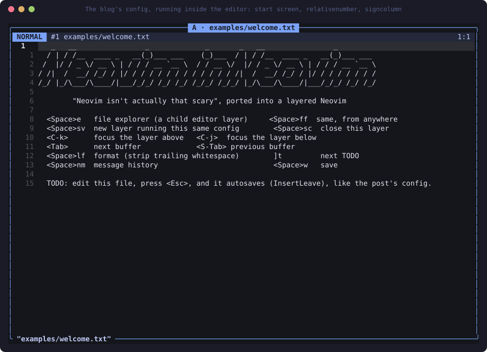<br><sub>The post's options + start screen, in Editor A.</sub></td>
<td width="50%">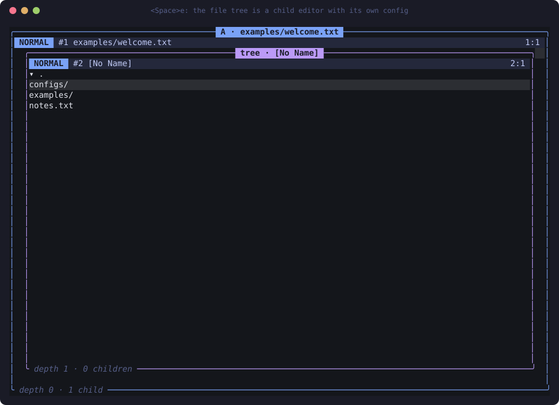<br><sub><code>&lt;Space&gt;e</code>: the file tree is a child editor.</sub></td>
</tr>
<tr>
<td colspan="2">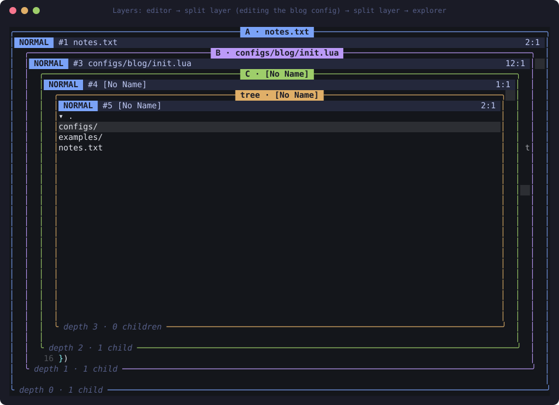<br><sub>Editor → a layer editing the blog config itself (autosaving on <code>&lt;Esc&gt;</code>) → another layer → the explorer.
The config is being edited from inside the config it describes, then <code>:reload</code>ed.</sub></td>
</tr>
</table>

Real terminal test: [`tests/e2e_blog.py`](../tests/e2e_blog.py) (17 checks: raw `<C-k>`/`<C-j>` bytes, autosave to disk from a real `<Esc>`, edit the config from a layer and reload it).

## Configuring an editor (it looks like configuring Neovim)

```lua
-- configs/a/init.lua  (executed by Editor A, in Editor A's private environment)
vim.g.mapleader = " "
vim.opt.number = true
vim.opt.tabstop = 4

vim.keymap.set("n", "Q", function() vim.editor.echo("Editor A") end)
vim.keymap.set("n", "<leader>n", function() vim.editor.spawn({ config = "configs/b/init.lua" }) end)

vim.api.nvim_create_user_command("Hello", function()
  vim.editor.echo("Hello from nested Neovim! (depth " .. vim.editor.depth() .. ")")
end, {})
```

`vim` here is a **virtual** object created per editor. The host's `vim` is not in the config's environment at all.

| area | API |
|---|---|
| options | `vim.opt` / `vim.o`: `number relativenumber cursorline wrap tabstop expandtab scrolloff signcolumn timeoutlen` |
| globals | `vim.g.mapleader` |
| mappings | `vim.keymap.set/del(mode, lhs, rhs\|fn)` for `n` `i` `v`, `<leader>`, multi-key, pending prefix with timeout |
| commands | `vim.api.nvim_create_user_command`, `vim.cmd("…")` |
| events | `vim.api.nvim_create_autocmd` for `ModeChanged BufWritePost ConfigLoaded EditorSpawn` |
| editor | `vim.editor.echo spawn insert_text scratch move_* motion feed exec edit save reload_config focus_parent close root depth …` |
| modules | `require("x")` resolves next to the config file |

**Reload is transactional**: the file runs against a *staging* scope; only if it finishes without error does it replace the editor's mappings,
commands and options in one swap. A broken config reports its error *in that editor*, keeps the previous working config, and never touches its
parent. Options that the new file no longer sets revert to defaults, and old mappings can't be duplicated by construction.

## How it works

<div align="center">
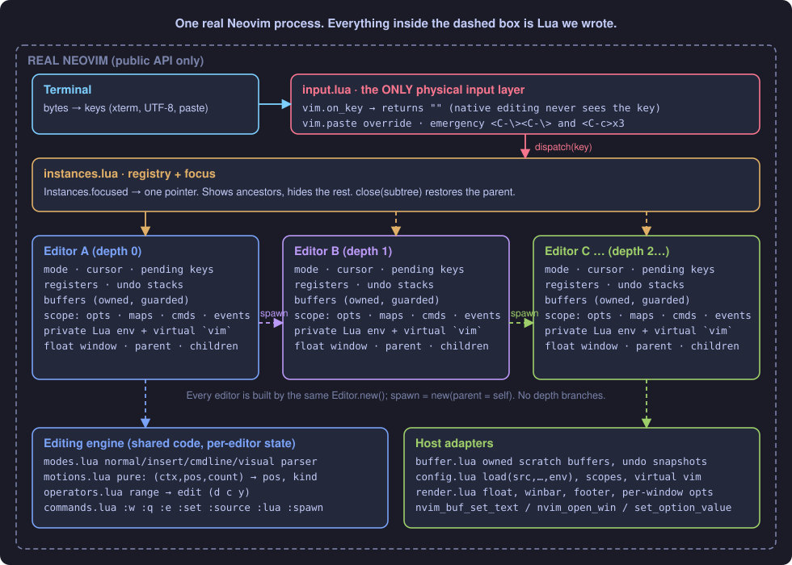
</div>

Neovim gives us three primitives: **a key arriving**, **a buffer**, and **a float window**. The runtime builds a complete modal editor from just those, and
because a child editor needs exactly the same three primitives, an editor can host another editor.

1. **Stealing the keyboard.** `input.lua` registers the only `vim.on_key` hook in the whole program. It returns `""` for every key, so Neovim's own
   Normal/Insert/`:` machinery never runs. It also overrides `vim.paste` (paste bypasses `on_key`) and reserves two emergency sequences.
2. **Routing.** The key goes to `Instances.focused`, one pointer. Focus moves on `spawn`, `:parent`, `:child`, `:close`.
3. **Per-editor state.** Mode, cursor, registers, undo, buffers, mappings, options and children all hang off the `Editor` object. Nothing is shared except
   the *code* (motions, operators, parser).
4. **Rendering.** `render.lua` is the only file that touches host windows. Each editor is a float; its options are *window-local* options of that float.

### A keypress is a pipeline, and `dw` is two independent parts

<div align="center">
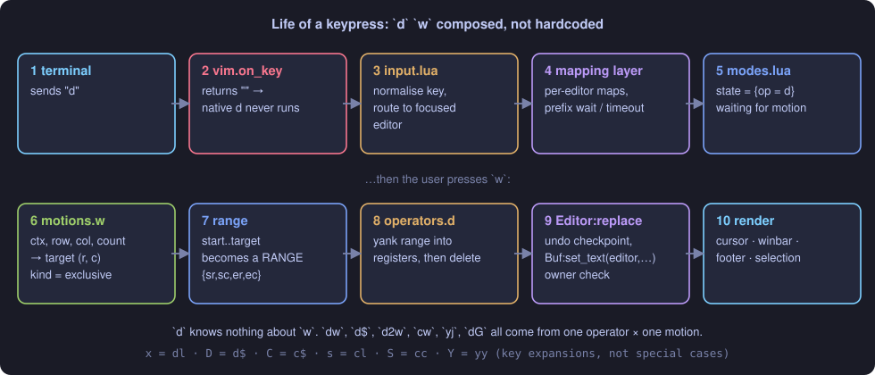
</div>

Operators and motions know nothing about each other. The parser produces a **range** from the motion and gives it to the operator, so adding one new
motion instantly gives you `d`, `c`, `y` and visual-mode support for it.

### Why configs can't contaminate each other

<div align="center">
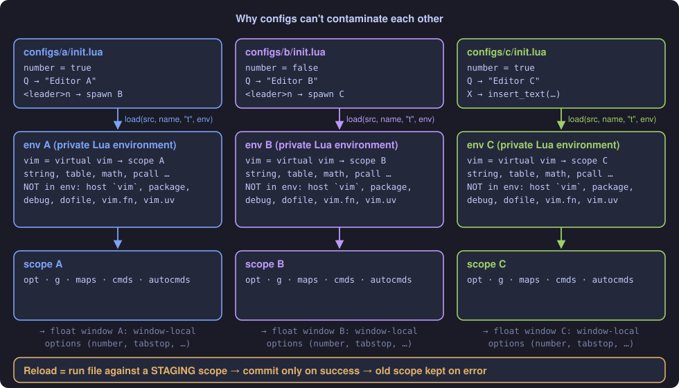
</div>

Each config is compiled with `load(src, name, "t", env)` where `env` holds a whitelist of Lua libraries and **that editor's** virtual `vim`.
What a config defines lands in a **scope** owned by one editor, and options are applied to that editor's window only.

### Reload is a transaction

<div align="center">
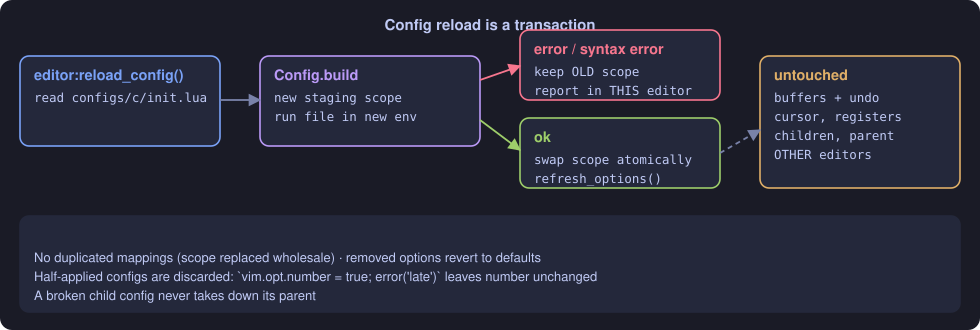
</div>

## Gallery (real screen captures, rendered from a pty running the actual editor)

<table>
<tr>
<td width="50%">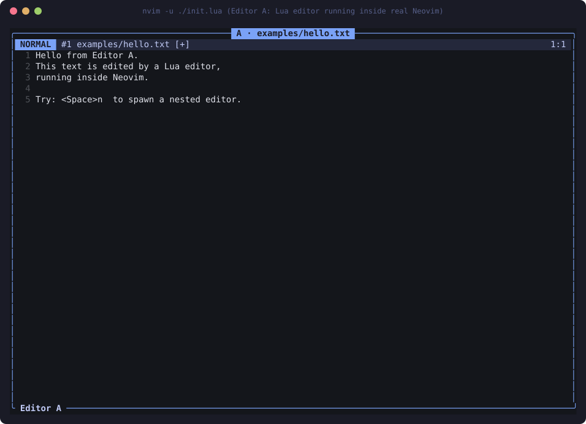<br><sub><b>Editor A</b>: numbers on, config A's mappings, own winbar.</sub></td>
<td width="50%">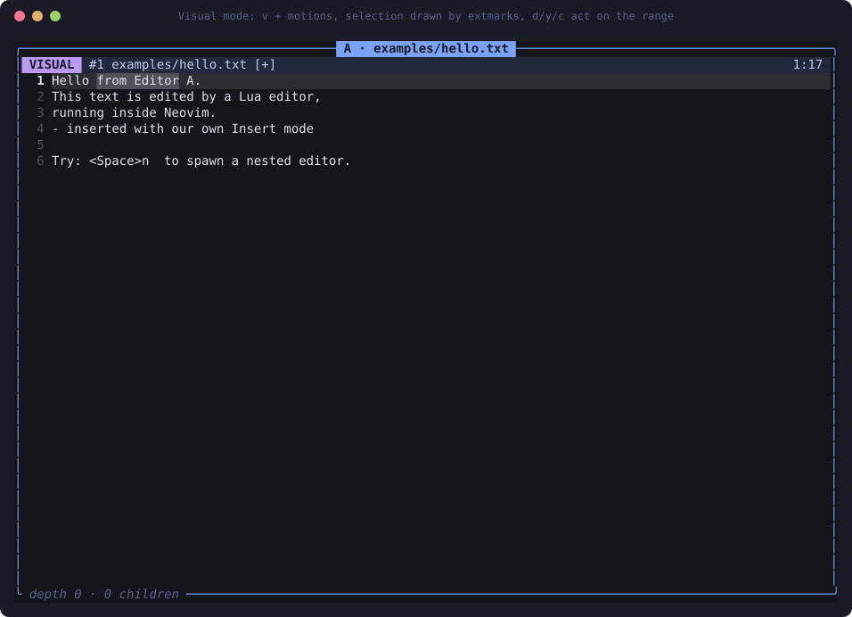<br><sub><b>Visual mode</b> drawn by extmarks; the host is still in Normal mode.</sub></td>
</tr>
<tr>
<td>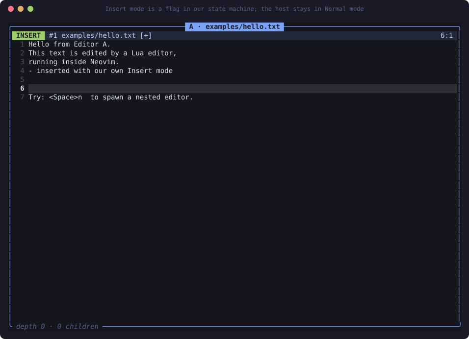<br><sub><b>Insert mode</b> is a flag in our state machine (green bar, bar cursor).</sub></td>
<td>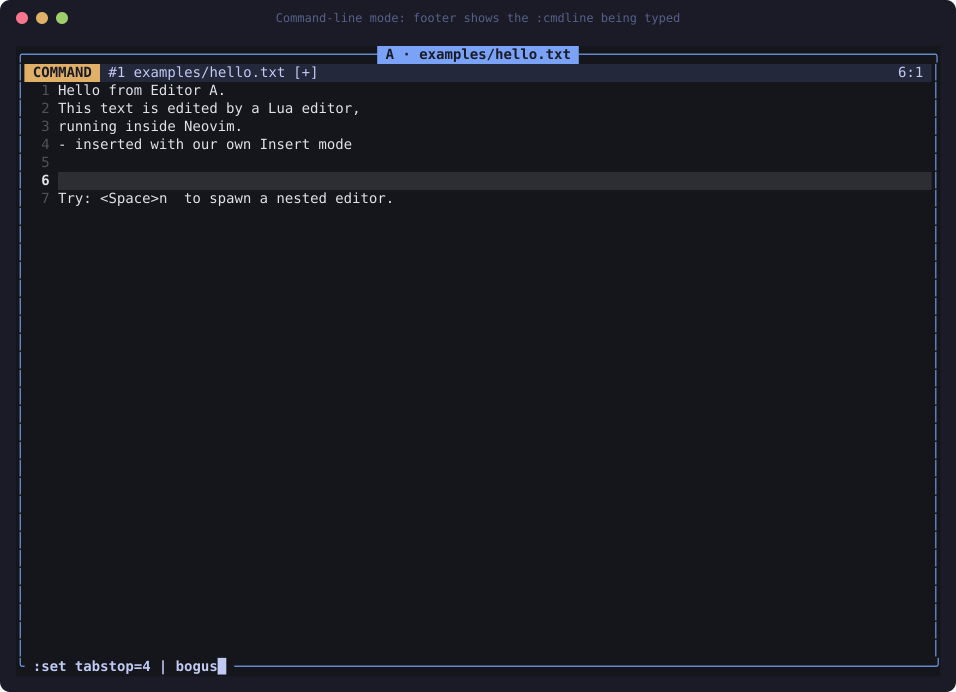<br><sub><b>Command-line mode</b>: footer shows the <code>:</code> line as you type.</sub></td>
</tr>
<tr>
<td>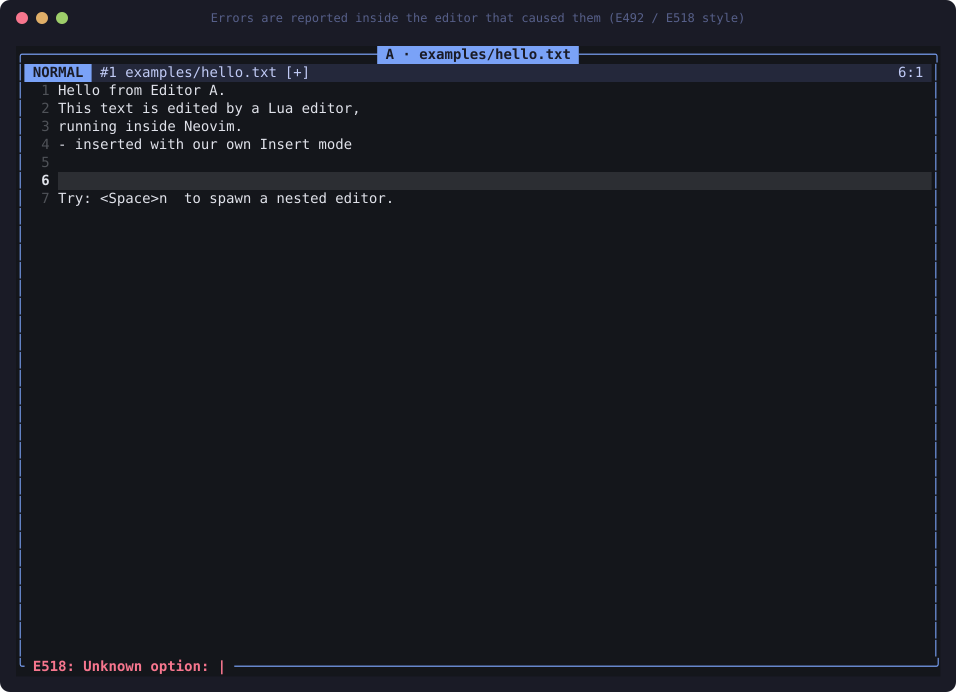<br><sub><b>Errors</b> are reported inside the editor that caused them.</sub></td>
<td>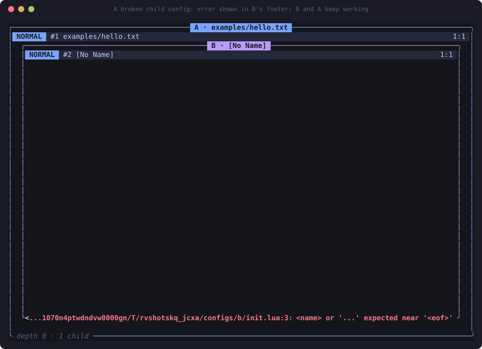<br><sub><b>Broken child config</b>: B shows the Lua error, still usable.</sub></td>
</tr>
<tr>
<td>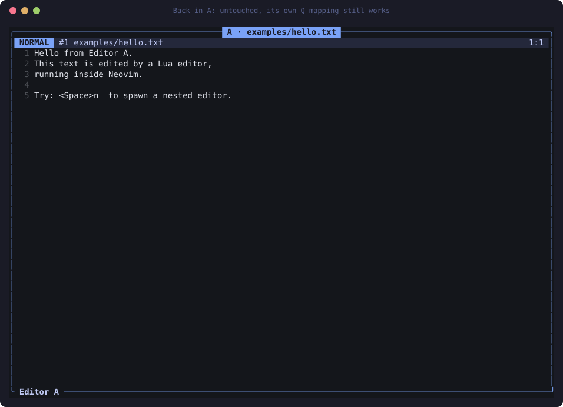<br><sub>…and <b>A is untouched</b>: its own <code>Q</code> still works.</sub></td>
<td><br><sub><b>B edits C's init.lua</b> and saves it with its own <code>:w</code>.</sub></td>
</tr>
</table>

Regenerate everything with `python3 tools/make_diagrams.py && python3 tools/make_screenshots.py` (needs `pip install pyte`).

* **One physical input layer.** `vim.on_key` swallows every key; a router hands it to whichever logical editor has focus. Nested editors never install hooks.
* **Buffers are real Neovim scratch buffers but logically owned.** Every mutation names the editor performing it; a different editor gets an error.
* **Options are display-adapted per instance** (`number` becomes a *window-local* option of that editor's own float), never a global host setting.
* **Depth is data.** `spawn` is just the constructor with a parent. There are no `if depth == 3` branches; the tests spawn eight levels.

More: [`docs/architecture.md`](../docs/architecture.md) · [`docs/input-research.md`](../docs/input-research.md) · [`docs/discoveries.md`](../docs/discoveries.md)

## Phase 0: could this even work?

Before writing the editor, the input approach was tested in a real pty (`experiments/`, 22 assertions). Findings worth knowing if you try this yourself:

* `vim.on_key()` returning `""` **does** reliably discard keys (incl. `i`, `x`, `dd`, `:`, `ZZ`, Ctrl combos, F-keys, 500-char bursts, Unicode).
* …**but a callback that throws is silently unregistered**, handing the editor back to native Vim. Everything is `pcall`'d.
* **Paste bypasses `on_key`** (`nvim_paste → vim.paste`), so pasting `dd` in Normal mode really deleted a line natively until `vim.paste` was overridden.
* The host cursor **clamps in Normal mode**, so "insert at end of line" typed text *backwards* until `virtualedit=onemore`.
* **`key` is post-mapping**: stock Neovim turns `X` into `dh` and `Y` into `y$` before your hook sees them (use `typed`), and ships 47 default mappings
  (some are Lua functions: the trigger for upstream [#36480](https://github.com/neovim/neovim/issues/36480)). We delete them all at startup.

## Tests

```bash
tests/run.sh
```

| layer | what | how |
|---|---|---|
| unit | motions, keys, registers | headless `nvim -l`, pure tables |
| integration | editing, counts, undo, dot, visual, `:` commands, config, reload, isolation, ownership, focus, cleanup, recursion to depth 8 | headless nvim with real buffers/windows; `input_spec` uses `nvim_feedkeys(…,"tx")` through the **real** `on_key` |
| end-to-end | the full A→B→C→edit→save→reload→isolate→D story + unicode, paste, escape sequences, 600-char bursts, no native leaks, "no new OS processes", `:q` exits | real `nvim -u ./init.lua` TUI in a pseudo-terminal, raw bytes, `pyte` virtual screen |

(`pip install pyte` is only needed for the dev-time pty tests. The editor itself has no dependencies.)

## Honest limitations

* Configs are **trusted code**. A private Lua environment isolates *names and state*, not capabilities (`os`/`io` are available).
* Not Vim: no regex search, folds, marks, macros, `:s`/`:g`, jump list, completion, mouse. Undo is linear whole-buffer snapshots.
* Insert counts (`3ix<Esc>`) are not implemented.
* A pending mapping prefix (like `<Space>` with `<leader>n`) waits `timeoutlen` (800 ms) before falling back to the builtin.
* There is one physical terminal, so cursor shape is global; it tracks the focused editor.
* If the hook ever wedges: `<C-\><C-\>`. (It runs inside the hook but ahead of all dispatch, so a broken editor can't block it.)

## Layout

```text
init.lua                 nvim -u ./init.lua  → boots Editor A
lua/recursive_vim/       the editor: input · instances · editor · modes · motions · operators ·
                         registers · buffer · commands · config · render · text · keys
configs/{a,b,c,d}/       the per-level init.lua files used by the demo/tests
configs/blog/            port of a real-world config (explorer layer, autosave, layers)
tests/                   lua specs + pty end-to-end + run.sh
experiments/             Phase-0 input interception research (reproducible)
tools/                   makes the README screenshots from a real pty session
docs/                    architecture · input-research · discoveries
```

<div align="center"><sub>Built as an educational systems-programming project: <i>can Neovim's config system express a smaller Neovim that has a config system?</i> Yes.</sub></div>
