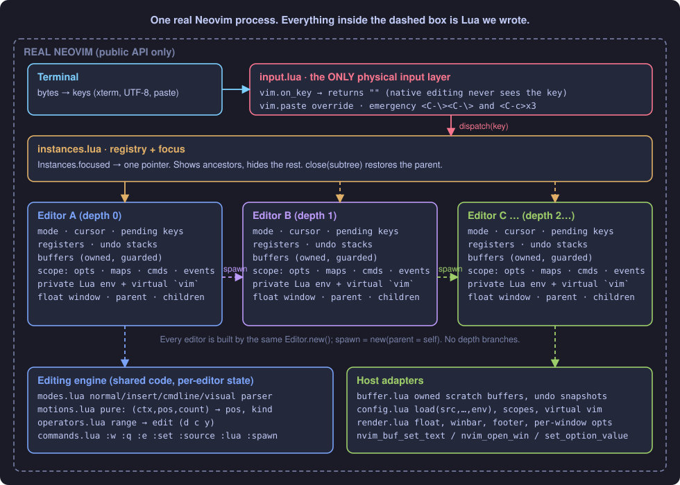
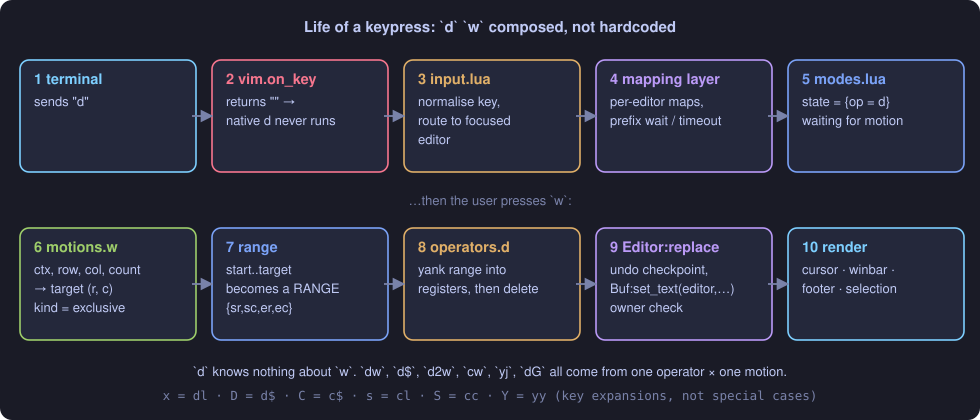
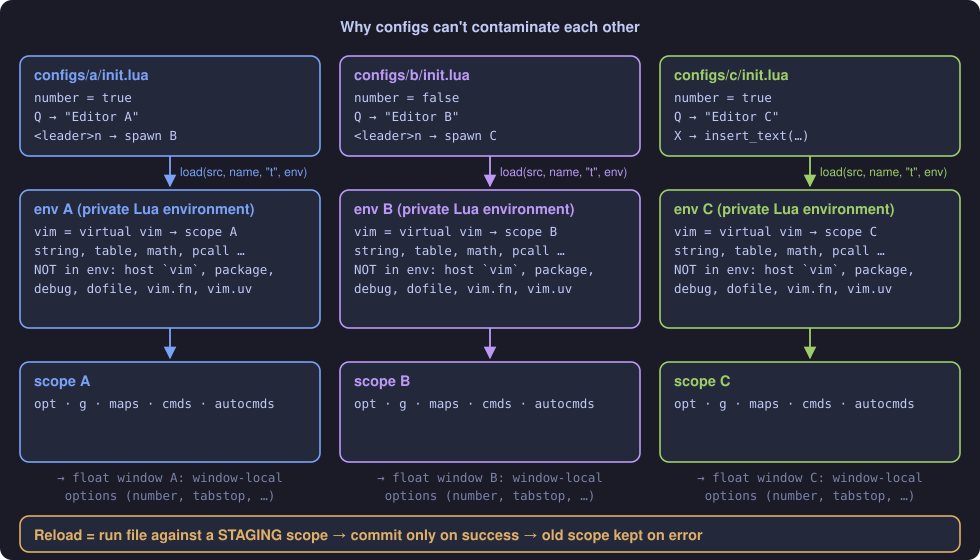
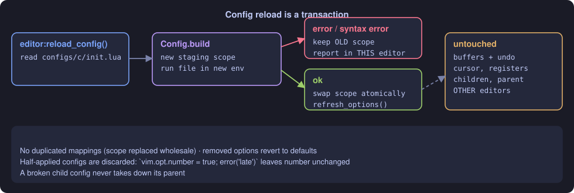

# Architecture

<div align="center"></div>

Text version of the same picture:

```
 terminal bytes
      │
      ▼
┌──────────────────────────── REAL NEOVIM (the only OS process) ────────────────────────────┐
│  vim.on_key(...)  ──returns ""──►  native Normal-mode machinery never sees the key         │
│  vim.paste = ...                                                                           │
│        │                                                                                   │
│        ▼                                                                                   │
│  input.lua  (single physical input layer, emergency keys)                                  │
│        │  dispatch(key)                                                                    │
│        ▼                                                                                   │
│  instances.lua ── focus ──►  Editor (focused)                                              │
│                                │                                                           │
│                                ├─ mapping layer (per-instance, prefix matching, timeout)   │
│                                ├─ modes.lua   normal/insert/command/visual state machine   │
│                                │      ├─ motions.lua    pure: (ctx,pos,count) -> pos       │
│                                │      └─ operators.lua  range -> edit (d c y)              │
│                                ├─ registers, undo stacks (per editor / per buffer)         │
│                                ├─ commands.lua  :w :q :e :set :source :lua :spawn ...      │
│                                ├─ config.lua    virtual `vim` + private Lua env            │
│                                ├─ buffer.lua    owned scratch buffer(s), guarded mutation  │
│                                └─ render.lua    float window, winbar, footer, options      │
└────────────────────────────────────────────────────────────────────────────────────────────┘
```

## One keypress, end to end

<div align="center"></div>

1. The terminal sends bytes; Neovim decodes them into a key and calls our `on_key` callback.
2. `input.lua` normalises the key (`keytrans` → canonical `<Esc>`, `<C-r>`, `é`), checks the emergency sequences, and calls
   `Instances.focused:feed(key)`. The callback returns `""`, so Neovim drops the key.
3. `Editor:feed` runs the **mapping layer**: if the editor is idle and its config defines mappings that start with the pending keys,
   it waits (up to `timeoutlen`), runs the match, or replays the keys through the built-ins.
4. Built-ins go to `modes.lua`. Normal mode parses `["x][count]operator[count]motion`; **`d` and `w` never reference each other** —
   the parser asks `motions.defs.w` for a target, converts (start, target, kind) into a *range*, and hands the range to `operators.defs.d`.
5. Edits go through `Editor:replace*` → `Buf:set_text/set_lines`. These take the calling editor and refuse if it is not the buffer's owner.
   The first edit of a command snapshots the buffer for undo (`u`, `<C-r>`), and sets a flag so `.` can replay the key list.
6. `render.refresh` syncs the host cursor, winbar (mode, file, pending keys, position), footer (message / `:cmdline`) and the visual selection.

## Instances
`Editor.new(opts)` is the **only** constructor. `editor:spawn(opts)` is `Editor.new` with `parent = editor`. There is no `if depth == …`
anywhere (the only depth-dependent things are *data*: the letter label and border colour). Each instance owns:

| state | where |
|---|---|
| mode, pending keys, cursor, wanted column | `Editor` fields |
| registers | `editor.regs` |
| buffers (+ undo/redo stacks) | `editor.buffers`, each `Buf.owner == editor` |
| options, mappings, user commands, events | `editor.cfg` (a *scope*) |
| Lua environment + virtual `vim` | `editor.cfg.env`, `editor.cfg.vim` |
| window (float) | `editor.win` |
| parent / children / active child | `editor.parent`, `.children`, `.active_child` |

**Focus** is a single pointer, `Instances.focused`. Focusing an editor shows it and its ancestors (the nested-frames look) and hides every
other float. Closing an editor closes its subtree first, wipes their buffers, and focuses the parent.

## Configuration runtime

<div align="center"></div>

```lua
local fn = load(src, "@configs/c/init.lua", "t", env)   -- env = { vim = <virtual vim>, string=..., math=..., ... }
```
* `env` contains a whitelist of standard Lua libs and a **virtual `vim`**. The host `vim` is not in `env`, so a config that says
  `vim.opt.number = true` can only reach *its* editor. (State isolation, **not** a security sandbox: `os`/`io` are available, configs are trusted.)
* `vim.opt`, `vim.g`, `vim.keymap`, `vim.api.nvim_create_user_command`, `vim.api.nvim_create_autocmd` write into the editor's *scope* table.
* `vim.editor.*` is our own API (`echo`, `spawn`, `insert_text`, `move_*`, `focus_parent`, `reload_config`, …).
* Option writes become **window-local / buffer-local** host options on that editor's own float (`render.apply_options`); nothing becomes a global.
  The single exception is the one physical cursor shape (`guicursor`), which reflects the focused editor's mode.

### Reload = build a new scope, commit only on success

<div align="center"></div>

```
load_config(path):
    scope = Config.build(editor, path)   # runs the file against a *staging* scope; editor untouched
    if error: report in this editor, KEEP old scope, return false
    editor.cfg = scope                   # swaps mappings/commands/events/options atomically (no duplicates by construction)
    refresh_options()                    # options no longer set by the file revert to defaults
    # buffers, cursor, registers, undo history, children: untouched
```
Other editors are never involved. A half-applied config (an option set, then an `error()`) is discarded.

## Why tests look the way they do
| level | file | what |
|---|---|---|
| unit | `tests/editing_spec.lua` (top) | pure motions, key parsing, registers |
| integration | `editing_spec`, `config_spec`, `recursion_spec`, `input_spec` | real buffers/windows in headless nvim; `input_spec` pushes keys through the **real** `on_key` pipeline via `nvim_feedkeys(…, "tx")` |
| end-to-end | `tests/e2e_pty.py` | real `nvim -u ./init.lua` TUI in a pty, raw bytes, pyte screen, full A→B→C→edit→reload→isolation→D story |
| research | `experiments/` | the Phase-0 input interception matrix |

Run everything with `tests/run.sh`.
